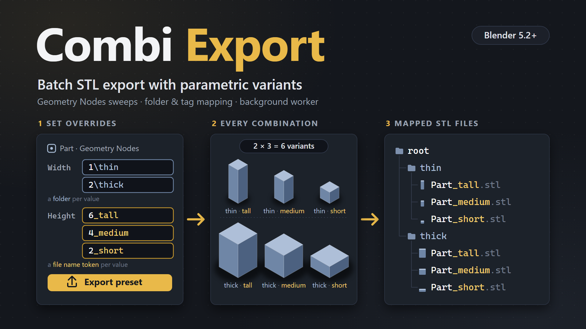

# Combi Export

A high-performance batch export pipeline and parametric permutation engine for Blender 5.2+. Built around a custom vectorized NumPy binary STL generator and an adaptive dual-path execution engine, it enables one-click exporting of scene collections, multi-dimensional parameter sweeping via Geometry Nodes and modifiers, and automated variant generation.

---

## Architecture & Technical Overview

For in-depth architectural details, execution flowcharts, and engine design, see [ARCHITECTURE.md](ARCHITECTURE.md).

* **Blender Version Support:** Blender 5.2.0+ (Manifest schema v1.0.0, extension version 1.0.0).
* **Package Format:** Blender 5.2 Extension (`blender_manifest.toml`).
* **Design Philosophy:** Non-destructive execution, isolated subprocess execution for mutations, and zero undo-stack pollution.

---

## Core Features

### 1. Vectorized Binary STL Generator
* **NumPy Direct Memory Buffering:** Reads vertex coordinates, face indices, and loop normals directly into continuous memory buffers via `foreach_get`.
* **Vectorized Transformations:** Transforms vertex positions and face normals using SIMD matrix arithmetic in NumPy, accounting for world matrices and negative determinant winding flips.
* **Instances Included:** Unrealized Geometry Nodes instances are exported together with the object's own mesh.
* **Instant Disk Streaming:** Meshes with hundreds of thousands of triangles are triangulated, evaluated, and streamed to disk in milliseconds.

### 2. Adaptive Dual-Path Execution Model
* **Direct Fast Path:** Exports without node overrides or parameter sweeps are evaluated natively in the current Blender process and written directly to disk, a few objects per timer tick so the interface keeps redrawing, while the background worker for the other objects boots.
* **Headless Background Worker (Safe Isolation Path):** When geometry node overrides, modifier changes, or parameter sweeps are present:
  - Automatically creates a temporary copy of the `.blend` file.
  - Spawns an isolated background Blender worker (`--factory-startup --python-exit-code 1 -b <temp.blend> -P ...`).
  - Switches on exactly what each batch exports in its copy (`lc.exclude`), whatever the view layer says, and excludes every other collection so it is ignored during geometry updates. What a node or modifier reads from an excluded collection (cutters, a base mesh) is still evaluated.
  - Restores baseline socket connections and values after export.
  - Keeps the main Blender viewport and UI completely responsive and interactive. Undo, switching scenes and reordering presets do not interrupt a running export.
* **Scripted Export:** `bpy.ops.export_scene.batch_stl_multi(preset_index=0)` runs the same export from a script or the command line (`blender -b file.blend --python-expr "import bpy; bpy.ops.export_scene.batch_stl_multi()"`; without `preset_index` it exports the active preset). The call waits for the background worker, prints the export log, and returns once every file is written. Problems (missing root folder, invalid overrides, colliding paths, a worker crash) raise a `RuntimeError`.

### 3. Hierarchical Parameter Overrides (8 Tiers)
Define temporary parameter overrides and sweeps across an 8-tier hierarchy:
`Global` → `Preset` → `Collection` → `Object` → `NodeGroup` → `Node` → `Input Socket` → `Value / Sweep`

* **Override Semantics:** A more specific level replaces the inherited value of the same socket (an Object value replaces a Collection, Preset or Global value). Several values on the *same* level are variants and are all exported. The inherited node group or node keeps its folder and tag: a Global block `\G` over Size writes `G/3/Box.stl` once an object sets Size 3.
* **Target Flexibility:** Target either exposed modifier interface sockets (`<Modifier Interface>`) or specific internal nodes within a Geometry Node tree, including the `Group Output` node (its unlinked inputs set what the group outputs).
* **Type Auto-Detection:** Automatically inspects the node tree interface and infers socket data types (`FLOAT`, `INT`, `BOOLEAN`, `STRING`, `MENU`). Other socket types (vectors, colors, objects, ...) are flagged as unsupported and block the export until removed.
* **Menu/Enum Auto-Populate:** Lists the items of every menu socket: Menu Switch nodes, menus on the modifier interface (also behind reroutes and nested groups), group node menus and the menus of built-in nodes (e.g. *Merge by Distance* mode).

### 4. Parametric Sweeping & Combinatorial Engine
Generate variant permutations across any socket. A sweep is typed in the value field (see *One Field per Value*), or Shift + click the value's `+` button to switch it into sweep mode:
* **Float / Int Ranges:** `start:step:count`, e.g. `0:0.5:5` gives `0, 0.5, 1, 1.5, 2` (1 to 1000 steps). `\0:0.5:5` puts each value in its own folder, `_0:0.5:5` adds it to the file name. Every step must be a different value, so a step of `0` is rejected (it would write the same files again), and numbers must be finite (`nan` and `inf` are rejected).
* **String Lists:** `{a, b, c}`, a comma-separated list in braces, each string once.
* **Sweep to Values:** Shift + the sweep button turns a sweep back into one value per step; steps the input already has as values are left out.
* **Boolean & Menu Combinations:** `*` iterates through `True`/`False` or all enum options (`\*` a folder each, `_*` a filename token each).
* **Branch-Aware Combinations:** Every parameter combination is generated, except where an override is limited to one branch of the folder tree (see *Branch Merging*). Such an override only multiplies the permutations of that branch.

### 5. Predictive Directory Tree & Overwrite Protection
* **Interactive Nested UI Hierarchy:** Calculates permutations ahead of time and displays an interactive directory hierarchy using collapsible nested UI boxes and indentation. Dedicated toolbar buttons let you quickly toggle the Global View, Expand All, Collapse All, or recursively Expand Last subdirectory.
* **Pre-Export Clash Detection:** The tree view highlights output paths written more than once. Every export checks all of its output paths first (no matter how many) and stops with an error if two files would land on the same path, before anything is written.
* **Decoupled UI Cache:** Background timer cache (~10Hz). Variant counts are computed without listing the variants whenever every combination of values is exported; only branch-limited setups are counted one by one, up to 5,000 per object (shown as `5000+`). The tree preview shows up to 5,000 files.

### 6. Power-User Shortcuts & Ergonomics
* **Shift + Up/Down Arrows:** Shift + Up moves an override group to the parent tier (e.g., from Object up to its Collection). Shift + Down copies it to every nested child tier and removes it from the current one (e.g., from Preset down to all its Collections, or Collection down to all its Objects).
* **Shift + Add Input (+):** Auto-populates all available and exposed inputs for the selected Geometry Node.
* **Instant Deletion:** Emptying a Node Group, Node, Input, or Value field (and submitting) instantly deletes the iteration. A group that was just added has an empty name field, with no clear button of its own: its row shows an X that removes it. Clearing a value field (or clicking its clear button) deletes the value, and the input when it was the last value, in a single undo step.
* **Validation Check:** Real-time socket validation rejects invalid inputs/nodes and instantly reverts to the last known valid state.
* **Override Button:** A level without overrides (Global, Preset, Collection, Object) shows no override table. An override button at the start of the counts row (of the Root folder row for the Global level) adds the first group (plus a paste button while a copied group is on the clipboard). Once the level has groups, the table appears and the button turns into an X that clears every group of that level in one undo step; when the level is empty again, the override button returns. Adding or pasting a group opens the level's table if it was collapsed, so the new group is visible right away.
* **List Buttons:** Add, remove, move, copy and paste of presets and collections are a column of buttons on the right of each list. The JSON import / export buttons sit in the Root folder row, and the `Root:` label is right-aligned against its field.
* **Clear View:** The arrow of an override table that has inputs collapses only its node group and node rows: the inputs and their values stay listed and editable. An input whose node group or node merges shows the merge icon at the start of its row (red when that block never applies); hover it for the merge details.

### 7. Scoped Live Console & Progress Tracking
* **Preset-Isolated Logging:** Each export preset tracks its own console log and export duration.
* **Real-Time Progress Streaming:** Non-blocking background worker output is piped directly into the Blender panel with operation counters and elapsed time display.
* **Auto-View Switching:** Flips to the live console when an export starts, and allows instant cancellation.
* **Side Tool Column:** Clear the log or toggle Verbose output directly from the side column tools.
* **Per-File Error Reporting:** A file that cannot be written (e.g. locked by a slicer) is logged as `FAILED` and the export continues with the next file.

### 8. Collection Mapping & Granular Exclusion Filters
* **Collection Bindings:** Map multiple collections per preset, configure custom sub-folder destinations, and add collection tags to the filename. Each collection has an export tick: untick it to skip it without losing its settings.
* **Object-Level Filtering:** Enable or disable specific mesh objects within collections without affecting viewport visibility. Renamed objects keep their settings.
* **The Ticks Decide, Not the View Layer:** The collection and object ticks alone decide what is exported, so the panel always shows what an export writes. A collection excluded in the view layer or disabled in viewports (monitor icon, also on a parent collection), and an object disabled in viewports, are exported all the same: the background worker switches them on in its copy of the file, so they come with their modifiers, and the open file stays as it is. A ticked collection the view layer does not evaluate shows an info icon. A mapped collection that is not in the scene at all is linked into the worker's copy. Hiding with the eye icon never mattered. Files and JSON presets from before the ticks keep exporting the same files: what the view layer did not evaluate comes in unticked.
* **Per-Object Overrides:** Assign distinct tags, sub-folders, and dedicated node override groups down to individual objects.

### 9. Dynamic Tagging & Directory Formatting
* **File Name:** The name field of an object in the object list starts out as the object name. Type another name to export the object's files under it; clear the field to go back to the object name (which then follows renames again). Names have no spaces: they are written as `_`, so an object `My Box` shows and exports as `My_Box`.
* **Filename Structure:** The file name (object name unless edited) followed by every tag token in hierarchy order, joined with `_`:
  `Object` → Global override tags → Preset override tags → Collection tag → Collection override tags → Object tag → Object override tags.
  Example: object `Box`, Global letter `A`, collection tag `v2`, Collection number `1`, object tag `lid` → `Box_A_v2_1_lid.stl`.
* **Collection and Object Tags:** Plain filename tokens placed at their level (several tokens separated by `/`; leading/trailing `_` are ignored, so `_lid` and `lid` are the same). The object tag no longer renames the object. Spaces are not allowed in tags, sub-folders and the preset root directory either: a space inside a name is replaced by `_` when you enter it (`my tag` becomes `my_tag`), and spaces at the edges or around a `/` are dropped.
* **One Field per Value:** Each value is one text field holding the value and how it is named. `\` starts the folder section and `_` the filename section, and the value is written where it goes in the names. A missing section means no folder / no token.

  | Field | Folder | File name | Meaning |
  |---|---|---|---|
  | `15` | | `Box` | the value only |
  | `\15` | `15/` | `Box` | a folder per value |
  | `_15` | | `Box_15` | a filename token per value |
  | `\15\_15` | `15/` | `Box_15` | both (the `\` before `_` closes the folder) |
  | `\big` | `big/` | | your name instead of the value (the value stays, it is not shown) |
  | `_big` | | `Box_big` | your token instead of the value |
  | `\15_mm` | `15_mm/` | | one folder joining the value and text |
  | `\size_15` | `size_15/` | | text before the value works too |
  | `_15_mm` | | `Box_15_mm` | the token joined with text |
  | `\B\15` | `B/15/` | | folder `B`, then a folder per value |
  | `_B_15` | | `Box_B_15` | token `B`, then the value |
  | `\big\_15` | `big/` | `Box_15` | a typed folder and the value's token |
  | `\big\_small` | `big/` | `Box_small` | your names for both |
  | `\0:0.5:5` | `0/` … `2/` | | a sweep: `start:step:count` |
  | `_{a, b}` | | `Box_a`, `Box_b` | a string list |
  | `\*` | one per item | | every menu item, or `True` and `False`; replaces the input's other values |

  **Your names and the value:** a field whose names replace the value shows only the names (`\big`); hover the icon before it to see the value. Every name that is not the value is your own text and merges into an upstream folder / token of that name (`\A` on a value inside the `A` branches only, see *Branch Merging*). When you type, the value is read like this:
  - The value the field holds, written in the names (`\B\15`, `\15_mm`), stays the value: edit the names around it freely.
  - A value typed where the old one was changes it: `\15` → `\16`, `\B\15` → `\B\16`, `\15_mm` → `\16_mm` (also `\16` on a value that had no folder yet). But when that name exists upstream, it is your name and merges: with a folder `2` upstream, `\2` on `\15` keeps 15 and merges into `2`.
  - Sweeps (`\0:1:5`, `\*`, `_{a, b}`) and values with a space are always the value.
  - Anything else is your name and the value stays: `\big` on 15 is folder `big`.
  - Write the value first to set both at once: `16\big`, `2\` (value 2, a folder per value).
  - When the text can be read both ways, the list offers the other reading: `2\…` (*Value 2*) for a name that merges, `\"16"` (*Typed names, the value stays 15*) for a value typed in its place. Quotes keep a name as your text (`\"16"`).

  **Shortcuts:** a section that ends in its separator goes on with the value: `\B\` = `\B\15`, `_B_` = `_B_15`, `15\` = `\15`, `15_` = `_15`.

  **Tab completion:** type the start of an upstream name and press Tab: it is completed together with its separator (`\A` → `\A\`, `_x` → `_x_`), and you can type the next name right away (`\A\1` → `\A\1\`). Tab stops where names differ (`\A\1` with `1` and `15` upstream), like a shell; matching is case-sensitive. Press Enter on `\A\1\` to merge into `A/1` with a folder per value after it, or delete the last `\` to make `1` your name instead of the value. The node group and node naming fields complete the same way (`\A` → `\A\`).

  **Underscores:** inside a folder section `_` belongs to the name (`\15_mm` is one folder), except right after `\` or a space, where the filename section starts (`\big\_15`, `\big _15`). In the value part `_` starts the filename section after the longest text that is a value: `15_big` is 15 with the token `big`, while a string `my_text` or a menu item `Mode_A` stay whole. A space before `_` ends the value earlier: `my_text _x`.

  A new input starts with its value only (`15`): one value applies to every file. Adding a value with `+` or switching to a sweep (Shift + `+`) makes the input permute, so values without naming get a folder each (`\15`, `\16`) and the files don't overwrite each other. When the input already names its values, a new value takes that naming instead (`_15` → `_16`, `\B\15` → `\B\16`); naming you typed is never changed. A blank new value (a string) keeps its naming when you type the value without a section. Typing `*` works like Shift + `+`: it already holds every item, so the input's other values are removed, and the sweep keeps the value's naming (or gets `\`) unless you type a section yourself.

  Double quotes make text literal: never the value and never a section mark (`"a\b"`, `"a_b"_x`; a quote inside quotes is written `""`). A typed name that would be read as the value is shown in quotes: `\"15"\15` is folder `15`, then a folder per value. Spaces around the sections do not matter. In a node group or node field a space inside a typed name becomes `_` (`\my dir` is `\my_dir`); in a value field typed names have none (text with a space is read as a value, which is written with `_` in the names: `my text` gives `my_text`). Typed names cannot hold `< > : " / \ | ? *`. Text that does not fit the input (a letter in a number, an unknown menu item, a value the input already has) is rejected and the field shows the stored value again. Menu items are matched case-insensitively.
* **Icon before each value:** Hover it to see what the field gives (`Value: 5`, `Folder: A / 5`, `Filename token: x_5`) and what merges. It shows a folder or tag icon, the blue merge icon when a folder / token merges into an upstream one, and turns red when the value can never apply.
* **Value Naming Rules:**
  - The value's own folder / token (with the text joined to it, `15_mm`) and anything after it is always new. Every other name is typed and merges into an upstream folder / token of the same name (see *Branch Merging*).
  - **Chains:** typed names before the value merge one branch level after another. `\B\2\15` goes into folder `B`, then its folder `2`: `B/2/15`. `_B_2_15` goes into token `B`, then its token `2`: `Box_B_2_15`. With letters `A B` and numbers `1 2` upstream, only the `B_2` files get the value; `A_1`, `A_2` and `B_1` stay as they are. A name in the chain that does not exist yet is created at that point: `_B_new_15` → `Box_B_1_new_15`, `Box_B_2_new_15`.
  - A tag chain is split at `_`, but a token that exists upstream keeps its `_`: with a value `a_b` upstream, `_a_b_15` merges into that token. The branch's own tokens decide first, so `_a_b_15` also merges into `a` and `b` coming from two inputs.
  - A joined folder (`\size_15`) comes from the value, so `size` itself never merges; a block or a later value can merge into `size_15`.
* **Node Group and Node Naming:** The naming field of a node group or node row uses the same sections without a value: `\C\2\_B` puts everything in the block into folders `C/2` and adds the token `B`. Text typed without `\` / `_` is a folder (`C/2` = `\C\2`). Clearing the field removes the block's folder and token (the block stays).

### 10. Branch Merging
Values with a folder or filename tag create branches, e.g. letters `A B C` × numbers `1 2 3` give `A/1 … C/3` (folders) or `Box_A_1 … Box_C_3` (names). An override further down the stack can be attached to an existing branch instead of multiplying every permutation:
* **Merge by Folder:** When a node group or node folder (`\B`), or a value folder, names a folder that already exists upstream, the override merges into it. A value merges through the typed folder names in its `\` section: `\B` (your name `B` instead of the value) or `\B\15` (merges into `B`, then a folder per value inside it: numbers `1 2` → `B/1`, `B/2`, while `A` and `C` stay as they are). A folder made from the value itself (`\15`, or the value folder after `\B\`) is always new, so two inputs that share a value (`1`, `True`, a menu item) still multiply: `A=1, B=1` → `1/1`. Its own folders are created inside the branch, below the folders already there.
* **Merge by Filename:** The same works with filename tokens (again, only typed tokens merge: `_B` replaces the value, `_B_15` merges into `B` and adds the value after it, so numbers `1 2` → `Box_B_1`, `Box_B_2`, while `Box_A` and `Box_C` stay as they are). Chains like `_B_2_15` narrow the merge to a branch of a branch (see *Value Naming Rules*). A node group, node or value token that names an upstream token only applies to the files that already contain it, and its own tokens are appended at the end of the name: `_B` → `Box_B_1_X`, `Box_B_1_Y`, … while `Box_A_*` and `Box_C_*` stay as they are. `C_2` and `2` work like their folder counterparts. Folder and tag anchors of one block must both match.
  - Block `\B` → only the B permutations get the new values: `B/1/X`, `B/1/Y`, … The A and C branches stay as they are.
  - Block `\C\2` → only `C/2/X`, `C/2/Y`, …
  - Block `\2` → every `2` branch: `A/2/X`, `B/2/X`, `C/2/X`, …
* **Matching Rules:** A name may match any parent folder (or any earlier token) of the branch, not only the last one. A preset prefix, collection or object sub-folder (or collection / object tag) equal to the neighbouring override folder (or token) collapses into it. Several names (`C/2`) must appear in that order. A branch name that is missing from a branch means the override does not apply there; any other name simply becomes a new folder.
* **Folders and Tags Together:** The `\` and `_` sections of a value (or of a block) are matched independently, so each can merge into a different branch, but both must fit the same files: `\B\15\_2_15` only applies where folder `B` and token `2` exist together; `\B\15\_A_15` never applies when `A` and `B` are values of one input.
* **Node Group and Node:** A node's folder and tag are matched after its group's, on their own: they may merge into the group's folder / token (group `X` + node `X` → `X`). The group's folder and tag mean the same for every node of the group.
* **Upstream Suggestions:** Value and naming fields are searchable. The section typed last lists the folders / name tokens that exist above the field, labelled *Branch* / *Name branch* (created by a value) or *Folder* / *Tag* (a plain block folder or tag) with their source. Free text is still allowed. In block paths the suggestion completes the last name, so typing `\C\` offers `\C\1\`, `\C\2\`, … In a value field the typed names before the value are completed, each with the value after it and ending in its separator (which Tab fills, see *Tab completion*): `\B\` offers `\B\1\15`, `\B\1\`, `\B\2\15`, `\B\2\`; `_B_` offers `_B_1_15`, `_B_1_`, … A value without sections offers `\15` and `_15`, and each upstream name to merge into (`\B\15`, `_B_15`); a section not typed yet is offered next to the other one (`\B\15\_15`). Menus and booleans also list their items (and `*`) when the field opens and while the value typed first is not one of them, keeping the naming.
* **Branch-Aware Predictions:** Suggestions only list chains the export will actually merge:
  - names that can exist together with the merges already made above the field, across folders and tags: inside a block placed in folder `C`, the alternatives `A` and `B` are not offered, and neither are folders or tokens that only exist under `A`;
  - names that still fit the other section: in `_B_15\`, the folder section only offers folders that exist in files with token `B`;
  - in chain order: after `\2\` only names that come after `2` in a path (`A` made before `2` is not offered);
  - only after a chain that merges as a whole, and never names of values that never apply.
* **Merge Highlighting:** A node group or node that merges shows a blue *Merges into …* bar on top of its block (folders first, then `name …` for tokens), covering everything inside it, and its naming field shows the merge icon. A value whose folder or tag merges shows the blue merge icon before its field. Hover the bar or icon to see where each folder comes from.
* **Dead Merge Warning:** If the chosen folders can never exist together (e.g. `C/X` when `X` only exists under `A`), the bar turns red (*Never applies*) because that block is never exported. A value with such a folder or tag gets a red icon and a red field.

### 11. JSON Preset Portability & Clipboard Buffer
* **Import / Export Setup:** Save or restore presets, collections, object lists, export ticks, and override matrices to external JSON files. A file also holds the root folder and the global overrides, which apply to every preset, so imported presets write the same files as where they were exported. Import adds the file's presets and replaces the scene's root folder and global overrides with the file's; untick *Root Folder* or *Global Overrides* in the file browser's options to keep the scene's own. Files from before this change hold only presets and leave both alone. Presets saved before directory and tag were split into two fields reuse their old tag as the directory name, so their folders keep their names. Files and `.blend` data from version 1.0.0 keep their number, boolean and sweep values. JSON files and `.blend` data written with the earlier `value @folder #tag` field syntax are converted when they are loaded and export to the same paths (`15 @B\ #x_` shows as `\B\15\_x_15`).
* **Internal Clipboard:** Copy and paste presets, collections, and node groups between tiers with one click.

---

## Installation & Requirements

* **Blender:** 5.2.0 or newer.
* **Dependencies:** Standard Blender Python environment (`numpy` is included with Blender).
* **Installation:** Install as an extension from the Blender Preferences extensions menu or place the `combi_export` folder into your Blender extensions directory.

## Tests

`python tests/run.py` runs the test suite in headless Blender (set `BLENDER` to the executable if it is not in the default install location; `-k NAME` runs matching tests, `-v` lists them). It covers naming, the value field syntax, variant generation and branch merging, the STL writer, presets and migrations, the override table callbacks, and the export operator with a real background worker, invoked like the button and called from a script. The panels themselves need a window and are not covered; the override table is drawn into a recording layout to check its kept merge predictions, and the depsgraph handler is driven by real scene changes. Tests marked `expectedFailure` reproduce known bugs.
